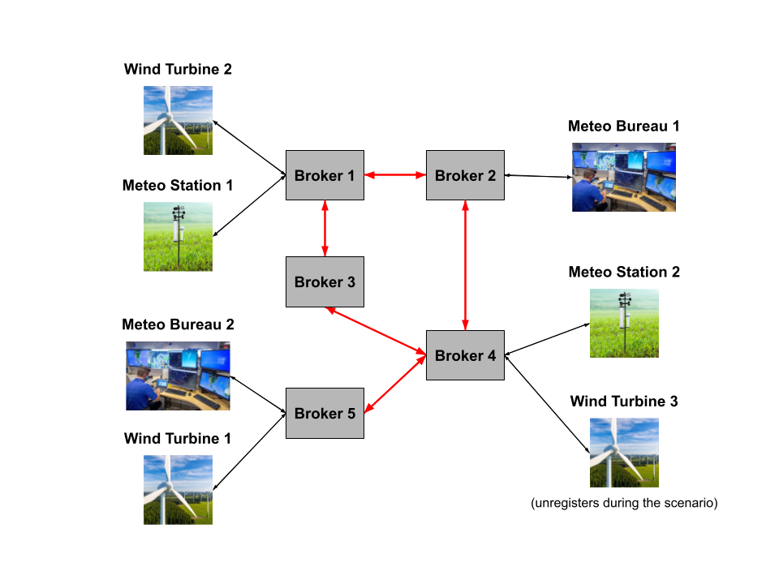
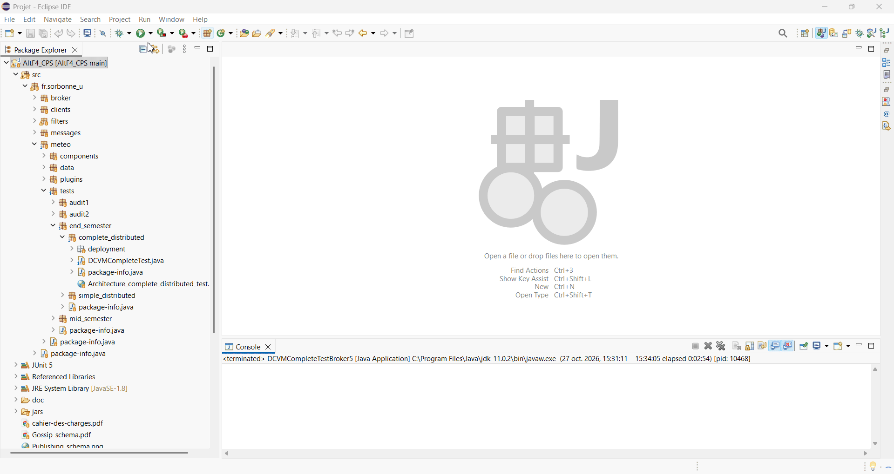

# 🎬 Demonstration

The demo shows the **complete distributed scenario** (`DCVMCompleteTest`): 5 brokers, each in its own JVM, connected through a gossip protocol.

**Component deployment** of the complete distributed scenario: 

**Wind turbine filters**:
- **Wind Turbine 1** accepts only weak, nearby winds and alerts on its region;  
- **Wind Turbine 2** accepts all winds and alerts on its region;  
- **Wind Turbine 3** accepts the same as Wind Turbine 2, but only from 80 s onwards.

**Scenario steps** (scenario time, run with an acceleration factor of 2):

| Step | Time | Action |
|---|---|---|
| **Part 1: filters** | | |
| 0 | 5 s | The 3 wind turbines subscribe to `channel0` (winds) and `channel1` (alerts). |
| 1 | 20 s | Meteo Bureau 2 sends an ORANGE flooding alert on Wind Turbine 1's exact position: received by Wind Turbine 1, which stays in service. |
| 2 | 40 s | Meteo Station 2 sends a strong wind: rejected byWind Turbine 1 (force filter) and Wind Turbine 3 (time filter), received by Wind Turbine 2. |
| 3 | 60 s | Meteo Bureau 2 sends a RED alert on Wind Turbine 3's position: rejected, too early for Wind Turbine 3's time filter. |
| 4 | 80 s | Meteo Bureau 2 sends a SCARLET alert on Wind Turbine 3's position: accepted, Wind Turbine 3 goes into safe mode. |
| 5 | 100 s | Wind Turbine 3 unregisters from the system. |
| **Part 2: privileged clients** | | |
| 6 | 120 s | Meteo Bureau 1 (PREMIUM) creates `testChannel`. |
| 7 | 140 s | Wind Turbine 1 unsubscribes from `channel0`/`channel1`; Wind Turbine 1 and Wind Turbine 2 subscribe to `testChannel`. |
| 8 | 160 s | Meteo Station 1 publishes a wind on `channel0`: only Wind Turbine 2 receives it. |
| 9 | 180 s | Meteo Station 1 publishes a wind on `testChannel`: Wind Turbine 1 and Wind Turbine 2 receive it. |
| 10 | 200 s | Meteo Bureau 1 restricts `testChannel` to Wind Turbine 1 only, implicitly unsubscribing Wind Turbine 2. |
| 11 | 220 s | Meteo Bureau 1 sends a GREEN alert on `testChannel`: received by Wind Turbine 1 only. |
| 12 | 240 s | Meteo Bureau 1 destroys `testChannel` and checks that it no longer exists. |
| **Part 3: concurrent load** | | |
| 13 | 260 s | Meteo Stations 1 and 2 each publish 1000 winds on `channel0`, in batches of 100. Brokers may purge old gossip messages (see their logs). |
| 14 | 280 s | Wind Turbine 2 checks it has received exactly 2003 winds since the start. |

# [EN] AltF4

**AltF4** is a component-programming project, implementing a minimal **Publish-Subscribe system** built with an academic framework (called BCM4Java, Java SE 8), applied to a weather application where weather stations and weather bureaus publish winds and alerts to wind turbines.

GitHub repository link: https://github.com/00David/AltF4_CPS  
The specifications are available [here](cahier-des-charges.pdf) (in french).  
Diagrams: [publication pipeline](Publishing_schema.png), [gossip protocol](Gossip_schema.pdf).  
Authors: Kevin Tang, David Vadimon.

## System

- **Publish/subscribe**: a broker component manages subscription channels, while weather client components (stations, bureaus, wind turbines) publish messages or subscribe to these channels, providing a filter on the messages to receive.
- **Distributed execution**: several broker components can be connected, each in its own JVM, through Java RMI: broker data is then synchronised by a **gossip protocol**, with each interaction spread to the other brokers (message reception for instance).
- **Multi-threaded components**: components, especially brokers, run with several thread pools.

## Main features

- **Composable message filters**: on property values, on several properties jointly, and on timestamps.
- **Subscribed client classes**: clients register under 3 service classes (FREE, STANDARD, PREMIUM), offering different privileges and performances.
- **Privileged clients**: channel creation, restriction (regex on client URIs) and destruction, within a quota.
- **Client plugins** for each class, with advanced message reception (notably asynchronous).
- **Weather application of messages**: stations publish winds, bureaus publish alerts, wind turbines orient themselves or switch to safe mode.

# [FR] AltF4

**AltF4** est un projet de programmation par composants, implantant un **système de publication/souscription** minimal réalisé avec un framework académique (BCM4Java, Java SE 8), appliqué à une application météo où des stations et bureaux météorologiques publient des vents et des alertes à destination d'éoliennes.

Lien du répertoire GitHub : https://github.com/00David/AltF4_CPS  
Le cahier des charges est disponible [ici](cahier-des-charges.pdf).  
Schémas : [pipeline de publication](Publishing_schema.png), [protocole de bavardage](Gossip_schema.pdf).  
Auteurs : Kevin Tang, David Vadimon.

## Système

- **Publication/abonnement** : un composant courtier gère des canaux d'abonnements, tandis que des composants clients météo (stations, bureaux, éoliennes) publient des messages ou s'abonnent à ces canaux, en fournissant un filtre sur les messages à recevoir.
- **Exécution répartie** : plusieurs composants courtiers peuvent être connectés, chacun dans sa JVM, par le biais de Java RMI : les données des courtiers sont alors synchronisées par un **protocole de bavardage**, avec chaque intéraction répandue aux autres courtiers (réception de message par exemple).
- **Composants multi-thread** : les composants, en particulier les courtiers, s'executent avec plusieurs pools de threads.

## Principales fonctionnalités

- **Filtres de messages composables** : sur les valeurs des propriétés, sur plusieurs propriétés conjointement, et sur les estampilles de temps.
- **Classe de clients abonnés** : enregistrement des clients selon 3 classes de service (FREE, STANDARD, PREMIUM), offrant différents avantages et performances.
- **Clients privilégiés** : création, restriction (regex sur les URIs clientes) et destruction de canaux, dans la limite d'un quota.
- **Application météo des messages** : les stations publient des vents, les bureaux des alertes, les éoliennes s'orientent ou passent en mode sécurité.
